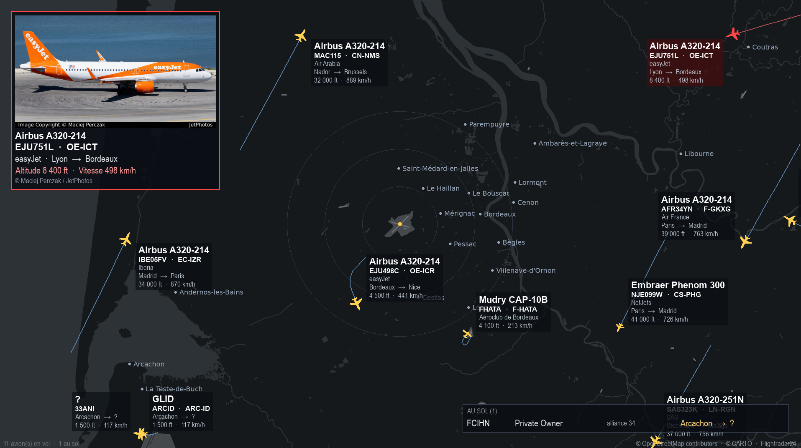

# Flight display

[🇫🇷 Français](README.md) · 🇬🇧 **English**

Flight display turns a Raspberry Pi and a screen into a **display board of the aircraft flying around your home**, in real time: a map of your neighborhood, the aircraft moving across it, and, for each one, its photo, airline, model, route, altitude and speed. When an aircraft comes close to your home, within a distance and below an altitude that you choose, an audible alert sounds and the screen focuses on that aircraft: you can follow it on the screen, or step outside and look up at the sky to spot it.

It is meant for aviation enthusiasts, for those who would rather look up at the sky than cover their ears when a plane goes by.

It is made to build a **head-up display**: a screen standing in the living room, the office or the workshop, permanently showing what is flying around you. **No mouse or keyboard is needed**: the Pi starts and displays by itself.



*Flight display on screen, around Bordeaux-Merignac airport. The photo credit (© its author, via JetPhotos) and the © OpenStreetMap contributors and © CARTO attributions are shown in the image.*

## What you see on the screen

- A vector map centered on your home, with distance circles, and the aircraft oriented along their heading. Each aircraft carries a label (model, airline, route, altitude, speed) that you can reorder and style.
- A photo card of the most interesting aircraft of the moment (customizable text: order, size, bold, italic) and the list of aircraft on the ground.
- A proximity alert: chime, blinking red tint and priority card when an aircraft enters the zone you defined, with an adjustable altitude range.
- Different colors depending on whether the aircraft type is known or not, to spot unusual aircraft at a glance.

## How you set it up: a small web interface

Once the Pi is installed, there is nothing to plug in to set it up. The Pi hosts a **small web interface** itself (called *webadmin* in this project): a page you open in the browser of your phone, tablet or computer, **as long as you are on the same network (the same router or Wi-Fi) as the Pi**. You just type its address, for example `http://flightdisplay.local:8080` (the name is the one you chose for the Pi in Raspberry Pi Imager). Nothing needs to be installed on the phone or computer, and the interface is not visible from the Internet. You can protect it with a password.

From this page, you can:

- **Control** the display: turn the screen on or off, mute the sound, adjust the volume live, restart or shut down the Pi, and set a weekly schedule for the screen.
- **Choose your position** on a small map, with a monitoring radius, and **customize the map style** (themes, colors, displayed elements, place names).
- **Adjust the look and behavior**: labels, photo card, distance circles, alert distance and altitude, aircraft colors, language (French or English), and aircraft types (classify the ones the program does not know yet).
- **Monitor** the Pi: temperature, processor, memory, disk, frames per second, and read the logs when something goes wrong.
- **Back up and restore** the whole configuration.
- **Update** the software straight from GitHub (published versions or development version), with a possible rollback to a previous version.

## And also

- Multilingual: French and English, for the interface and for the screen; other languages can be added with a simple file (`lang` folder).
- **Home Assistant** integration through MQTT (screen, sound, volume, temperature, aircraft in flight / on the ground / in the alert zone, active alert, frames per second, CPU, memory, disk).

## Important notice

This project is not affiliated with Flightradar24 or with any airline. Flight data is obtained with the unofficial [FlightRadarAPI](https://github.com/JeanExtreme002/FlightRadarAPI) library. Flightradar24's terms of use reserve automated access to the official (paid) API and limit the use of the service to personal, non-commercial use. Use this software for personal and educational purposes, at your own risk, and read the [Flightradar24 terms](https://www.flightradar24.com/terms-of-service). Do not use it for flight-safety decisions. The photos belong to their authors (JetPhotos) and are not redistributed by this repository; map data is © OpenStreetMap contributors, base map © CARTO.

## What you need

- **Any Raspberry Pi**: Zero, Zero 2 W, 3, 4, 5 or Compute Module. The Zero is the cheapest; from the Pi 3 on, the display is smoother and the map builds much faster, but the settings do not change.
- A microSD card of 16 GB or more, and an HDMI screen. For sound: the screen's speakers, the headphone jack if your model has one, or a USB sound card (the Pi Zero has no jack).
- An Internet connection: 2.4 GHz Wi-Fi on the Zero and Zero 2 W (no 5 GHz), Wi-Fi or Ethernet on the other models.
- **A CARTO API key** (free, see below), to enter in webadmin as soon as the installation ends. The automatic installation starts with a supplied map (Bordeaux-Merignac airport), but the key is still needed to build the map of your position and to customize the map style.

## Get a CARTO API key

**What it is for.** The background map (roads, water, airport runways) is drawn from the vector base map of [CARTO](https://carto.com/basemaps/), built on OpenStreetMap data. CARTO now requires an API key for any direct use of its base maps. In Flight display, the key is only used to build the background image (each time the map is rebuilt, and for the preview of the "Map style" page): it is not used during everyday operation. The automatic installation supplies a map of Bordeaux-Merignac airport and starts without a key; to display **your** position or change the style, enter the key in webadmin (Settings, Map and position), then rebuild the map.

**How to get it (about one minute, free, no CARTO account).**

1. Open [carto.com/basemaps/apikey](https://carto.com/basemaps/apikey/) from your computer or phone.
2. Enter your e-mail address, describe your use honestly (personal, non-commercial) and accept the [terms](https://carto.com/legal/basemap-terms/).
3. The key arrives by e-mail within moments. Keep it at hand: the installer will ask for it.

**Good to know.**

- Free for personal or non-commercial use, up to 5 million tiles per month, all your keys combined. Building a map uses only a tiny part of that. Commercial use is free up to 1 million tiles per month, then paid.
- The key is personal: do not share it and do not reuse it for unrelated projects. Never publish it (the `config.ini` file, which contains it, is not versioned by Git).
- The attribution "© OpenStreetMap contributors, © CARTO" must remain visible: Flight display always shows it at the bottom right of the screen (and in the "Credits" page of webadmin, link at the top of the interface), do not remove it. The photographer's credit is visible inside the image and repeated under each photo (can be turned off in Settings, Photo panel).
- You can install without a key: everything is installed except the map, which you will build later.

**Where it is stored.** In `config.ini`, section `[map]`, key `carto_key` (file with 600 permissions): the manual installation writes it, with the automatic installation you enter it yourself. To enter or change it: webadmin, Settings, Map and position, "CARTO API key" field (hidden), then, at the bottom of the same page, "Rebuild the map".

**Lost or rejected key.** If the map build fails with an HTTP 401 or 403 error, the key is probably wrong or invalid: request a new one on the same page, replace it in webadmin, then rebuild the map.

## One-command installation

1. With Raspberry Pi Imager, install **Raspberry Pi OS Lite** on the SD card: 32-bit on the Zero and Zero 2 W, 64-bit possible on newer models. In the customization options, set the hostname, a user, the Wi-Fi and enable SSH.
2. For a manual installation, have your **CARTO API key** ready (previous section); the automatic installation does not need it at first.
3. Connect to the Pi over SSH, then type:

```
bash <(curl -fsSL https://raw.githubusercontent.com/arcalulu/flightdisplay/main/install.sh)
```

By default, the installation is **automatic**: after a 15-second countdown (press a key or Ctrl+C to switch to manual, or use `--manual`), it installs by itself with a sample configuration (Bordeaux-Merignac airport) and a supplied map, with no MQTT and no password; the program starts at the end and you set everything from webadmin. In manual mode, the installer asks all its questions up front, `sudo` password included (address or coordinates, CARTO API key, web interface password, optional MQTT, screen fix, final reboot). What you type stays visible, passwords included. It then installs everything needed while showing its progress on a single line, builds the map and starts the display and the web interface. At the end, a summary gives the interface address (`http://<pi-name>.local:8080`), the username and the password. The installer asks for its language first (English or French, or `--lang en`), and writes it to the configuration for webadmin and the screen.

Without `curl`: `sudo apt update && sudo apt install -y git && git clone https://github.com/arcalulu/flightdisplay.git ~/flightdisplay && bash ~/flightdisplay/install.sh`.

The installer exists in French and in English (`--lang en`) and can run with no question at all for a script (`--yes`, with `FD_*` variables): see the documentation (section 0.7).

Running the same command again later updates the software and keeps your configuration.

## Documentation

The full guide (manual installation, reference of all settings, webadmin, MQTT, troubleshooting) is in [docs/FLIGHT_DISPLAY_DOCUMENTATION.en.md](docs/FLIGHT_DISPLAY_DOCUMENTATION.en.md). It is also available in French: [documentation française](docs/FLIGHT_DISPLAY_DOCUMENTATION.md).

## Updating

The easiest way: web interface, **Updates** tab. "Check for updates" queries GitHub, "Update" downloads and installs the new version while showing the progress step by step (if anything goes wrong, the previous version is restored automatically). An "update available" chip appears at the top of the page: hover it and an icon lets you start the update directly.

Or on the command line:

```
cd ~/flightdisplay
git pull
fd restart
sudo systemctl restart flightadmin
```

or run the installer again. Your settings (`config.ini`, which also holds those of the web interface) are not touched: they are not versioned.

## License and credits

Code under the MIT license (see [LICENSE](LICENSE)). The libraries used (pygame, requests, FlightRadarAPI, paho-mqtt) have their own licenses. The third-party data, services and photos (OpenStreetMap, CARTO, Flightradar24, JetPhotos), their terms and how the software complies with them are detailed in [CREDITS.md](CREDITS.md).
