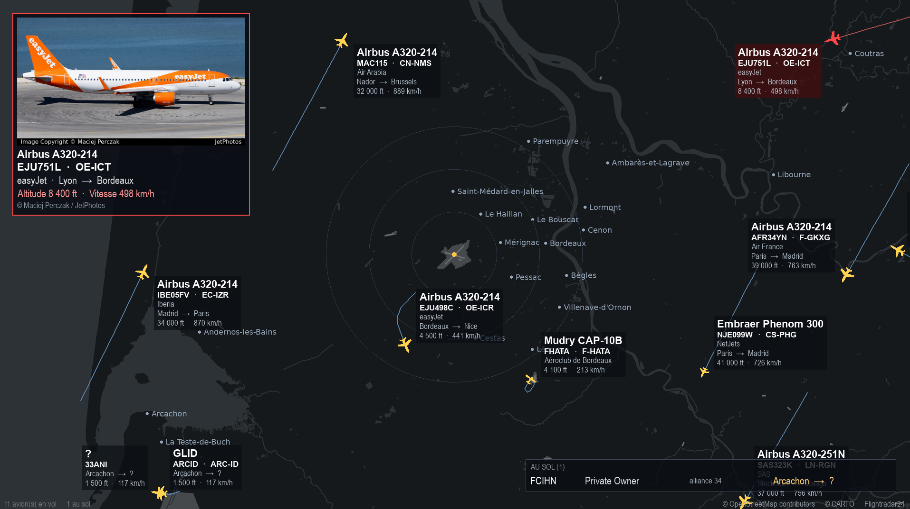

# Flight display

🇫🇷 **Français** · [🇬🇧 English](README.en.md)

Flight display transforme un Raspberry Pi et un écran en **tableau d'affichage des avions qui volent autour de chez vous**, en temps réel : une carte de votre quartier, les avions qui s'y déplacent, et, pour chacun, sa photo, sa compagnie, son modèle, son trajet, son altitude et sa vitesse. Quand un avion passe près de chez vous, l'affichage vous prévient (carillon et teinte rouge).

C'est fait pour réaliser un **écran tête haute** : un écran posé dans le salon, le bureau ou l'atelier, qui affiche en permanence ce qui vole autour de vous. **Aucune souris ni aucun clavier n'est nécessaire** : le Pi démarre et affiche tout seul.



*Flight display à l'écran, autour de l'aéroport de Bordeaux-Mérignac. Le crédit de la photo (© son auteur, via JetPhotos) et les attributions © OpenStreetMap contributors et © CARTO sont affichés dans l'image.*

## Ce que l'on voit à l'écran

- Une carte vectorielle centrée sur votre domicile, avec des cercles de distance, et les avions orientés selon leur cap. Chaque avion porte une étiquette (modèle, compagnie, trajet, altitude, vitesse) que vous pouvez réordonner et mettre en forme.
- Une fiche photo de l'avion le plus intéressant du moment (texte personnalisable : ordre, taille, gras, italique) et la liste des avions au sol.
- Une alerte de proximité : carillon, teinte rouge clignotante et fiche prioritaire quand un avion entre dans la zone que vous avez définie, avec une plage d'altitude réglable.
- Des couleurs différentes selon que le type d'avion est connu ou non, pour repérer d'un coup d'œil les appareils inhabituels.

## Comment on le règle : une petite interface web

Une fois le Pi installé, il n'y a rien à brancher pour le régler. Le Pi héberge lui-même une **petite interface web** (que ce projet appelle *webadmin*) : une page que vous ouvrez dans le navigateur de votre téléphone, de votre tablette ou de votre ordinateur, **tant que vous êtes sur le même réseau (la même box ou le même Wi-Fi) que le Pi**. Il suffit de saisir son adresse, par exemple `http://flightradarpi.local:8080` (le nom est celui que vous avez choisi pour le Pi dans Raspberry Pi Imager). Il n'y a rien à installer sur le téléphone ou l'ordinateur, et l'interface n'est pas visible depuis Internet. Vous pouvez la protéger par un mot de passe.

Depuis cette page, vous pouvez :

- **Piloter** l'affichage : allumer ou éteindre l'écran, couper le son, régler le volume en direct, redémarrer ou éteindre le Pi, et programmer un planning hebdomadaire d'allumage de l'écran.
- **Choisir votre position** sur une petite carte, avec un rayon de surveillance, et **personnaliser le style de la carte** (thèmes, couleurs, éléments affichés, noms de lieux).
- **Régler l'apparence et le comportement** : étiquettes, fiche photo, cercles de distance, distance et altitude d'alerte, couleurs des avions, langue (français ou anglais), et les types d'avions (classer ceux que le programme ne connaît pas encore).
- **Surveiller** le Pi : température, processeur, mémoire, disque, images par seconde, et consulter les journaux (logs) en cas de souci.
- **Sauvegarder et restaurer** toute la configuration.
- **Mettre à jour** le logiciel directement depuis GitHub (versions publiées ou version de développement), avec retour possible à une version précédente.

## Et aussi

- Multilingue : français et anglais, pour l'interface comme pour l'écran ; d'autres langues s'ajoutent avec un simple fichier (dossier `lang`).
- Intégration **Home Assistant** par MQTT (écran, son, volume, température, avions en vol / au sol / dans la zone d'alerte, alerte en cours, images par seconde, CPU, mémoire, disque).

## Avertissement important

Ce projet n'est affilié ni à Flightradar24 ni à aucune compagnie. Les données de vol sont obtenues avec la bibliothèque non officielle [FlightRadarAPI](https://github.com/JeanExtreme002/FlightRadarAPI). Les conditions d'utilisation de Flightradar24 réservent l'accès automatisé à l'API officielle (payante) et limitent l'usage du service à un usage personnel et non commercial. Utilisez ce logiciel à titre personnel et éducatif, à vos propres risques, et consultez les [conditions de Flightradar24](https://www.flightradar24.com/terms-of-service). Ne l'utilisez pas pour des décisions liées à la sécurité des vols. Les photos appartiennent à leurs auteurs (JetPhotos) et ne sont pas redistribuées par ce dépôt ; les données cartographiques sont © OpenStreetMap contributors, fond de carte © CARTO.

## Ce qu'il vous faut

- **N'importe quel Raspberry Pi** : Zero, Zero 2 W, 3, 4, 5 ou Compute Module. Le Zero reste le plus économique ; à partir du Pi 3, l'affichage est plus fluide et la carte se construit beaucoup plus vite, mais les réglages ne changent pas.
- Une carte microSD de 16 Go ou plus, un écran HDMI. Pour le son : haut-parleurs de l'écran, sortie casque si le modèle en a une, ou carte son USB (le Pi Zero n'a pas de prise jack).
- Un accès Internet : Wi-Fi 2,4 GHz sur les Zero et Zero 2 W (pas de 5 GHz), Wi-Fi ou Ethernet sur les autres modèles.
- **Une clé API CARTO** (gratuite, voir ci-dessous), à saisir dans webadmin dès l'installation terminée. L'installation automatique démarre avec une carte fournie (aéroport de Bordeaux-Mérignac), mais la clé reste nécessaire pour construire la carte de votre position et pour personnaliser le style de la carte.

## Obtenir une clé API CARTO

**À quoi elle sert.** La carte affichée en fond (routes, eau, pistes d'aéroport) est dessinée à partir du fond de carte vectoriel de [CARTO](https://carto.com/basemaps/), construit sur les données OpenStreetMap. CARTO exige désormais une clé API pour toute utilisation directe de ses fonds de carte. Dans Flight display, la clé ne sert qu'à construire l'image de fond (à chaque reconstruction de la carte, et pour l'aperçu de la page « Style de la carte ») : elle n'est pas utilisée pendant le fonctionnement quotidien. L'installation automatique fournit une carte de l'aéroport de Bordeaux-Mérignac et démarre sans clé ; pour afficher **votre** position ou changer le style, saisissez la clé dans webadmin (Réglages, Carte et position), puis reconstruisez la carte.

**Comment l'obtenir (environ une minute, gratuit, sans compte CARTO).**

1. Ouvrez [carto.com/basemaps/apikey](https://carto.com/basemaps/apikey/) depuis votre ordinateur ou votre téléphone.
2. Saisissez votre adresse e-mail, décrivez votre usage honnêtement (personnel, non commercial) et acceptez les [conditions](https://carto.com/legal/basemap-terms/).
3. La clé arrive par e-mail en quelques instants. Gardez-la sous la main : l'installeur vous la demandera.

**Ce qu'il faut savoir.**

- Gratuit pour un usage personnel ou non commercial, jusqu'à 5 millions de tuiles par mois, toutes vos clés confondues. La construction d'une carte n'en consomme qu'une infime partie. L'usage commercial est gratuit jusqu'à 1 million de tuiles par mois, puis payant.
- La clé est personnelle : ne la partagez pas et ne la réutilisez pas pour des projets sans rapport. Ne la publiez jamais (le fichier `config.ini`, qui la contient, n'est pas versionné par Git).
- L'attribution « © OpenStreetMap contributors, © CARTO » doit rester visible : Flight display l'affiche en permanence en bas à droite de l'écran (et dans la page « Crédits » de webadmin, lien en haut de l'interface), ne la retirez pas. Le crédit du photographe est visible dans l'image et répété sous chaque photo (désactivable dans Réglages, Panneau photo).
- Vous pouvez installer sans clé : tout est installé sauf la carte, que vous construirez plus tard.

**Où elle est enregistrée.** Dans `config.ini`, section `[map]`, clé `carto_key` (fichier en droits 600) : l'installation manuelle l'écrit, avec l'installation automatique c'est à vous de la saisir. Pour la saisir ou la changer : webadmin, Réglages, Carte et position, champ « Clé API CARTO » (masqué), puis, en bas de la même page, « Reconstruire la carte ».

**Clé perdue ou refusée.** Si la construction de la carte échoue avec une erreur HTTP 401 ou 403, la clé est probablement incorrecte ou invalide : demandez-en une nouvelle sur la même page, remplacez-la dans webadmin, puis reconstruisez la carte.

## Installation en une commande

1. Avec Raspberry Pi Imager, installez **Raspberry Pi OS Lite** sur la carte SD : 32-bit sur Zero et Zero 2 W, 64-bit possible sur les modèles plus récents. Dans la personnalisation, renseignez le nom d'hôte, un utilisateur, le Wi-Fi et activez SSH.
2. Pour une installation manuelle, munissez-vous de votre **clé API CARTO** (section précédente) ; l'installation automatique n'en a pas besoin au départ.
3. Connectez-vous au Pi en SSH, puis tapez :

```
bash <(curl -fsSL https://raw.githubusercontent.com/arcalulu/flightdisplay/main/install.sh)
```

Par défaut, l'installation est **automatique** : après un compte à rebours de 15 secondes (une touche ou Ctrl+C pour passer en manuel, ou `--manual`), elle s'installe seule avec une configuration d'exemple (aéroport de Bordeaux-Mérignac) et une carte fournie, sans MQTT ni mot de passe ; le programme démarre à la fin et vous réglez tout depuis webadmin. En manuel, l'installeur pose toutes ses questions au début, mot de passe `sudo` compris (adresse ou coordonnées, clé API CARTO, mot de passe de l'interface web, MQTT facultatif, correctif d'écran, redémarrage final). Les saisies restent visibles, mots de passe compris. Il installe ensuite tout le nécessaire en affichant sa progression sur une seule ligne, construit la carte et démarre l'affichage et l'interface web. À la fin, un résumé donne l'adresse de l'interface (`http://<nom-du-pi>.local:8080`), l'identifiant et le mot de passe.

Sans `curl` : `sudo apt update && sudo apt install -y git && git clone https://github.com/arcalulu/flightdisplay.git ~/flightdisplay && bash ~/flightdisplay/install.sh`.

L'installeur existe en français et en anglais (`--lang en`) et peut se lancer sans aucune question pour un script (`--yes`, avec des variables `FD_*`) : voir la documentation (section 0.7).

Relancer la même commande plus tard met à jour le logiciel et conserve votre configuration.

## Documentation

Le guide complet (installation manuelle, référence de tous les réglages, webadmin, MQTT, dépannage) est dans [docs/FLIGHT_DISPLAY_DOCUMENTATION.md](docs/FLIGHT_DISPLAY_DOCUMENTATION.md). Elle existe aussi en anglais : [English documentation](docs/FLIGHT_DISPLAY_DOCUMENTATION.en.md).

## Mettre à jour

Le plus simple : interface web, onglet **Mises à jour**. « Vérifier les mises à jour » interroge GitHub, « Mettre à jour » télécharge et installe la nouvelle version en affichant la progression étape par étape (en cas de problème, la version précédente est restaurée automatiquement). Une puce « mise à jour disponible » apparaît en haut de la page : en la survolant, une icône permet de lancer la mise à jour directement.

Ou en ligne de commande :

```
cd ~/flightdisplay
git pull
fd restart
sudo systemctl restart flightadmin
```

ou relancer l'installeur. Vos réglages (`config.ini`, qui contient aussi ceux de l'interface web) ne sont pas touchés : ils ne sont pas versionnés.

## Licence et crédits

Code sous licence MIT (voir [LICENSE](LICENSE)). Les bibliothèques utilisées (pygame, requests, FlightRadarAPI, paho-mqtt) ont leurs propres licences. Les données, services et photos de tiers (OpenStreetMap, CARTO, Flightradar24, JetPhotos), leurs conditions et la façon dont le logiciel les respecte sont détaillés dans [CREDITS.md](CREDITS.md).
